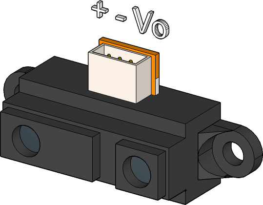
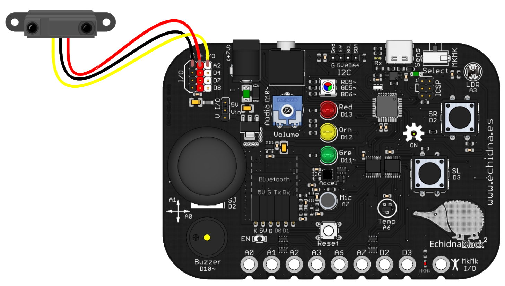
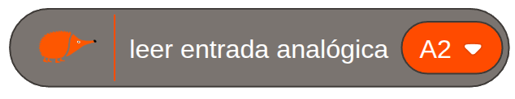
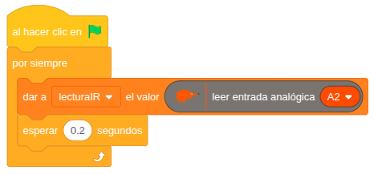

El sensor de distancia de infrarrojos mide **a qué distancia está un objeto** que tiene delante, sin tocarlo. Sirve para que un robot no choque, para contar a las personas que pasan por una puerta o para hacer un sistema de ayuda al aparcamiento.

## Descripción

El sensor tiene dos lentes: por una **emite luz infrarroja**, que no se ve, y por la otra recoge la que **rebota** en el objeto. Según dónde le llega la luz rebotada, da una tensión mayor o menor.

Tiene tres pines: alimentación (**+**), tierra (**−**) y la salida (**Vo**), que da la tensión que depende de la distancia.

Como su salida es analógica, se conecta al conector de entrada y salida **A2**, el único analógico: el cable **rojo** a +V, el **negro** a GND y el **amarillo** a la señal.

## Funcionamiento

La placa convierte la tensión del sensor en un valor de 0 a 1023. Hay que tener en cuenta tres cosas:

- **El valor sube cuanto más cerca está el objeto**: es al revés que la distancia.
- **La relación no es lineal**: el valor no cambia lo mismo por cada centímetro. Para saber la distancia exacta hay que calibrarlo, midiendo el valor a distancias conocidas.
- **La luz le afecta**: el sol o una luz intensa, con mucho infrarrojo, pueden falsear la medida.

El **alcance** depende del modelo de sensor: el Sharp GP2Y0A21YK0F, por ejemplo, mide de 10 a 80 cm.

Para usar A2, el selector de modo tiene que estar en modo sensores, porque en modo MkMk ese pin es la entrada MkMk2 ([Modo sensores / Modo MkMk](/ecosistema/echidnablack2/modo-sensores-mkmk/)).

## Cómo se programa

En **EchidnaML** no hay un bloque propio para este sensor: se lee con el bloque genérico **leer entrada analógica**, eligiendo la entrada **A2**. Da un valor de 0 a 1023.

## Ejemplos

### Sistema de ayuda al aparcamiento

Como los sensores de aparcamiento de los coches, el [zumbador](/ecosistema/echidnablack2/audio/) pita más deprisa cuanto más cerca está el obstáculo.

**1. Medir los valores.** Este programa lee el sensor cada 0,2 s y guarda el valor en la variable *lecturaIR*. Si se marca la casilla de la variable, su valor se ve en el escenario.

**2. Elegir los umbrales.** Con el programa en marcha, se pone un obstáculo delante del sensor a las distancias que se quieren distinguir y se apunta el valor de cada una. En el ejemplo, 200, 400 y 600: cuanto más alto, más cerca.

**3. El programa.** Al de la medida se le añade otro, también con su bandera verde, que funciona a la vez y hace pitar el zumbador según el valor de *lecturaIR*:

- **Menos de 200** (zona segura, el obstáculo está lejos): el zumbador está apagado.
- **De 200 a 400** (advertencia): pita y calla cada 0,2 s.
- **De 400 a 600** (peligro): pita más deprisa, cada 0,1 s.
- **600 o más** (choque inminente): pita muy deprisa, cada 0,05 s.
