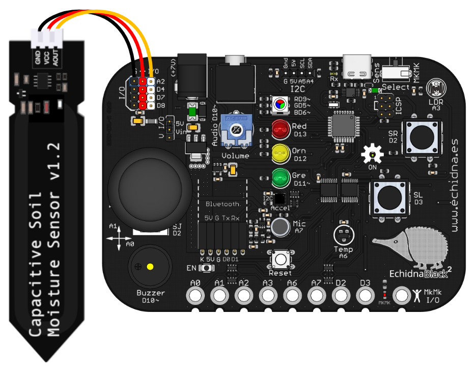

El sensor de humedad del suelo mide **cuánta agua hay en la tierra**. Se clava en una maceta o en el huerto del centro para saber cuándo hay que regar una planta, o para hacer un sistema de riego automático.

## Descripción

Tiene dos partes: los **electrodos**, la parte en forma de pica que se clava en la tierra, y un **circuito** que convierte la humedad que detectan en una señal eléctrica.

Su salida es analógica, así que se conecta al conector de entrada y salida **A2**, el único analógico: el cable **negro** a GND, el **rojo** a la alimentación (VCC) y el **amarillo** a la señal (Vout).

## Funcionamiento

Cuando la tierra tiene **más agua**, la conductividad entre los electrodos aumenta y el sensor da una **tensión mayor**; cuando está **seca**, la conductividad baja y la tensión también. La placa convierte esa tensión en un valor de 0 a 1023.

Los valores cambian según el modelo de sensor y el tipo de tierra, así que conviene **comprobarlos antes de usarlo**: medir el valor con la tierra seca y después de regarla, y elegir el umbral entre los dos.

Para usar A2, el selector de modo tiene que estar en modo sensores, porque en modo MkMk ese pin es la entrada MkMk2 ([Modo sensores / Modo MkMk](/ecosistema/echidnablack2/modo-sensores-mkmk/)).

## Cómo se programa

En **EchidnaML** no hay un bloque propio para este sensor: se lee con el bloque genérico **leer entrada analógica**, eligiendo la entrada **A2**. Da un valor de 0 a 1023.

## Ejemplos

### ¿Hay que regar la planta?

Los [LEDs](/ecosistema/echidnablack2/leds/) de la placa indican si la planta tiene agua suficiente: el **verde** si la humedad es adecuada y el **rojo** si hay que regarla.

El programa tiene dos partes que funcionan a la vez, cada una con su bandera verde:

- La de la **izquierda** lee el sensor cada 0,1 s y guarda el valor en la variable *humedad*.
- La de la **derecha** lo compara con el **umbral**, 600 en el ejemplo:
  - si la humedad es **mayor que 600**, la tierra está bien: enciende el LED verde y apaga el rojo;
  - si no, hay que regar: apaga el verde y enciende el rojo.

El umbral de 600 es el del ejemplo: el de cada maceta se elige midiendo antes con la tierra seca y con la tierra húmeda, como se explica en «Funcionamiento».
