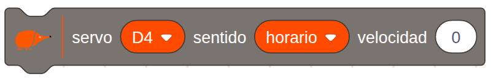

El servomotor de rotación continua es un motor que **gira sin parar**, en el sentido que se le indica, en lugar de ir a un ángulo. Sirve para mover las ruedas de un robot, una cinta transportadora o un tiovivo.

## Descripción

Por fuera es igual que un [servomotor de posición](/ecosistema/echidnablack2/complementos/servomotor-posicion/): un **motor de corriente continua** con una reductora y una electrónica de control dentro de la misma caja. La diferencia está en la electrónica, que en vez de llevar el eje a un ángulo controla el **sentido de giro** y permite ajustar un poco la **velocidad**.

Se conecta a uno de los conectores de entrada y salida de la placa: **D4, D7, D8 o A2**. Hay que fijarse en los colores de los cables: el **rojo** va a la alimentación (+V), el **negro** (o marrón) a tierra (GND) y el **amarillo** (o blanco) a la señal.

## Funcionamiento

Se controla con los mismos **pulsos** que el servomotor de posición, de entre 1 y 2 ms cada 20 ms, pero aquí el pulso no indica un ángulo: con un pulso de 1,5 ms el motor está **parado**, y cuanto más se aleja de ese valor, hacia un lado o hacia el otro, más rápido gira en un sentido o en el contrario. No hace falta generarlos a mano: el bloque de EchidnaML (o la librería Servo de Arduino) los calcula a partir del sentido y la velocidad.

Para conectar **varios** servomotores, conviene alimentar la placa con una fuente externa por el jack y poner el selector de las entradas y salidas en **Vin**, como se explica en [Alimentación](/ecosistema/echidnablack2/alimentacion/). Si se usa **A2**, el selector de modo tiene que estar en modo sensores, porque en modo MkMk ese pin es la entrada MkMk2 ([Modo sensores / Modo MkMk](/ecosistema/echidnablack2/modo-sensores-mkmk/)).

## Cómo se programa

En **EchidnaML**, el servomotor de rotación continua se controla con este bloque, en el que se elige:

- el **pin** al que está conectado: D4, D7, D8 o A2;
- el **sentido** de giro: horario o antihorario;
- la **velocidad**, de 0 a 100 %. Con 0, el motor se para.

## Ejemplos

### Control del sentido de giro con los pulsadores

Los [pulsadores](/ecosistema/echidnablack2/pulsadores/) eligen hacia dónde gira el servomotor, conectado a **D4**: con **SR** gira en sentido horario, con **SL** en sentido antihorario y, si no se pulsa ninguno, se para.

El programa tiene dos partes que funcionan a la vez, cada una con su bandera verde, y se comunican con dos variables: **velocidad** (100 para girar, 0 para parar) y **sentido** (horario o antihorario).

- La parte de la **izquierda** lee los pulsadores y decide qué hacer:
  - si SR está pulsado, sentido horario y velocidad 100;
  - si no, y SL está pulsado, sentido antihorario y velocidad 100;
  - si no se pulsa ninguno, velocidad 0.
- La parte de la **derecha** mueve el servomotor con el sentido y la velocidad de las variables. La espera de 0,1 s evita mandarle órdenes sin parar, lo que podría hacer que funcionara de forma inestable.
