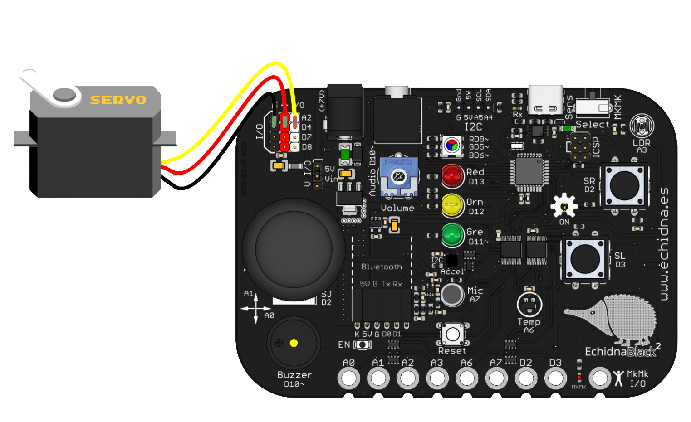
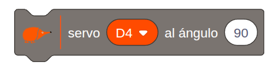
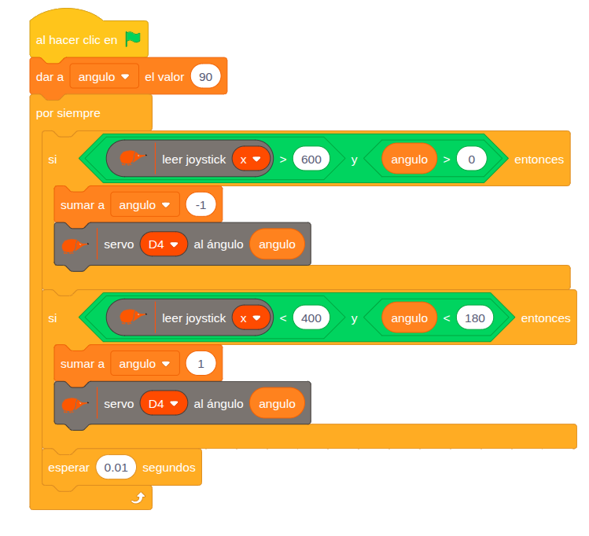

El servomotor de posición es un motor que se puede llevar a un **ángulo exacto**, entre 0 y 180º, y que se queda ahí. Sirve para mover una barrera, una veleta, el brazo de un robot o la aguja de un indicador.

## Descripción

Es un **motor de corriente continua** con una reductora y una electrónica de control dentro de la misma caja. La electrónica compara la posición del eje con la que se le pide y mueve el motor hasta llegar a ella.

Se conecta a uno de los conectores de entrada y salida de la placa: **D4, D7, D8 o A2**. Hay que fijarse en los colores de los cables: el **rojo** va a la alimentación (+V), el **negro** (o marrón) a tierra (GND) y el **amarillo** (o blanco) a la señal.

## Funcionamiento

El ángulo se indica con **pulsos** de entre 1 y 2 ms que se repiten cada 20 ms: cuanto más largo es el pulso, mayor es el ángulo. No hace falta generarlos a mano: el bloque de EchidnaML (o la librería Servo de Arduino) los calcula a partir del ángulo.

Un servomotor consume bastante cuando se mueve. Para conectar **varios**, conviene alimentar la placa con una fuente externa por el jack y poner el selector de las entradas y salidas en **Vin**, como se explica en [Alimentación](/ecosistema/echidnablack2/alimentacion/). Si se usa **A2**, el selector de modo tiene que estar en modo sensores, porque en modo MkMk ese pin es la entrada MkMk2 ([Modo sensores / Modo MkMk](/ecosistema/echidnablack2/modo-sensores-mkmk/)).

## Cómo se programa

En **EchidnaML**, el servomotor se mueve con este bloque, en el que se elige el pin al que está conectado (**D4, D7, D8 o A2**) y el ángulo, de **0 a 180º**:

## Ejemplos

### Control de posición con el joystick

El eje X del [joystick](/ecosistema/echidnablack2/joystick/) mueve el servomotor, conectado a **D4**. La variable *angulo* guarda la posición del servo y empieza en 90º, en el centro.

El programa comprueba sin parar hacia dónde se inclina el joystick:

- eje X **mayor que 600** y ángulo mayor que 0: resta 1 al ángulo y mueve el servo;
- eje X **menor que 400** y ángulo menor que 180: suma 1 al ángulo y mueve el servo.

Con el joystick en reposo (en torno a 512) no se cumple ninguna de las dos condiciones y el servo se queda quieto. Las condiciones sobre el ángulo evitan pedirle al servo una posición fuera de 0-180º, y la pequeña espera al final de cada vuelta hace que se mueva de forma suave.
